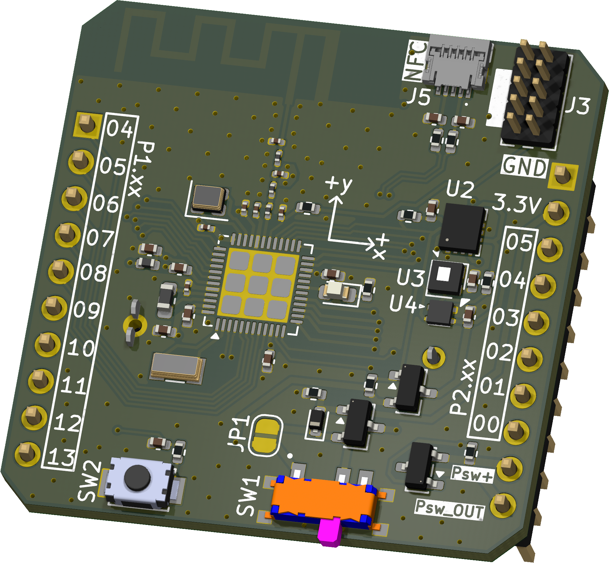
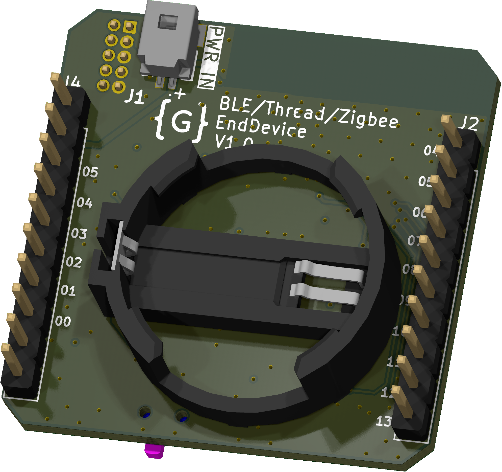

  

<h1 align="center">BLE/Thread/Zigbee EndDevice</h1>

  Low-power wireless sensor board based on the nRF54L15 for BLE Mesh, Thread/Matter and Zigbee

  
  

***

## ABOUT

BTZ-EndDevice is a battery-powered sensor node designed by GoodByte to compare BLE Mesh, Thread/Matter and Zigbee
on the same hardware.

  
&nbsp; &nbsp; &nbsp; &nbsp;
  

***

## SPECIFICATIONS

| Parameter | Value |
| --- | --- |
| SoC | Nordic nRF54L15  |
| Sensors | STS4x (temperature), LTR-329ALS-01 (light), BMI270 (IMU), switchable power |
| Power | CR2032 coin cell or external supply, jumper JP1 for current measurement |
| Interfaces | SWD, GPIO headers, NFC antenna connector, button, LED |
| PCB | 35.0 × 35.0 mm, 4 layers |

***

## DESIGN FILES

All files below are generated by KiBot in CI.

| File | Description |
| --- | --- |
| [Schematic](Schematic/BTZ-EndDevice-schematic.pdf) | Full schematic (PDF) |
| [BOM (CSV)](Manufacturing/Assembly/BTZ-EndDevice-bom.csv) · [BOM (HTML)](Manufacturing/Assembly/BTZ-EndDevice-bom.html) | Bill of materials |
| [Interactive BOM](Manufacturing/Assembly/BTZ-EndDevice-ibom.html) | Component placement viewer (download and open in a browser) |
| [Pick and place](Manufacturing/Assembly/BTZ-EndDevice-CPL.csv) | Component positions for assembly |
| [Assembly drawing](Manufacturing/Assembly/BTZ-EndDevice-assembly.pdf) | Assembly drawing (PDF) |
| [Gerbers](Manufacturing/Fabrication/BTZ-EndDevice-GERBERS.zip) | Fabrication files (ZIP) |
| [Fabrication drawing](Manufacturing/Fabrication/BTZ-EndDevice-fabrication.pdf) | Stackup, drill and fabrication notes (PDF) |
| [3D model](3D/BTZ-EndDevice.step) | Board model (STEP) |
| [Test points](Testing/Testpoints/BTZ-EndDevice-testpoints.csv) | Test point positions and nets (CSV) |

***

## DIRECTORY STRUCTURE

    .
    ├─ 3D                 # STEP model of the board
    ├─ HTML               # Generated web page with all outputs
    ├─ Images             # Renders
    │
    ├─ kibot_resources    # External resources for KiBot
    │  ├─ colors          # Color theme for KiCad
    │  ├─ fonts           # Fonts used in the project
    │  ├─ scripts         # External scripts used with KiBot
    │  └─ templates       # Templates for KiBot generated reports
    │
    ├─ kibot_yaml         # KiBot YAML config files
    ├─ KiRI               # KiRI (visual schematic and PCB diff between revisions)
    │
    ├─ Library            # KiCad footprint and symbol libraries
    │  ├─ 3D Model        # Component 3D models
    │  ├─ Footprint       # Footprint libraries
    │  └─ Symbol          # Symbol libraries
    │
    ├─ Logos              # Logos
    │
    ├─ Manufacturing      # Assembly and fabrication documents
    │  ├─ Assembly        # Assembly documents (BOM, pick and place, notes)
    │  └─ Fabrication     # Fabrication documents (Gerbers, drill tables, notes)
    │
    ├─ Schematic          # Schematic PDF
    ├─ Templates          # Title block templates
    └─ Testing
       └─ Testpoints      # Test point tables

***

## LICENSE

This project is licensed under the MIT License, see [LICENSE](LICENSE).
